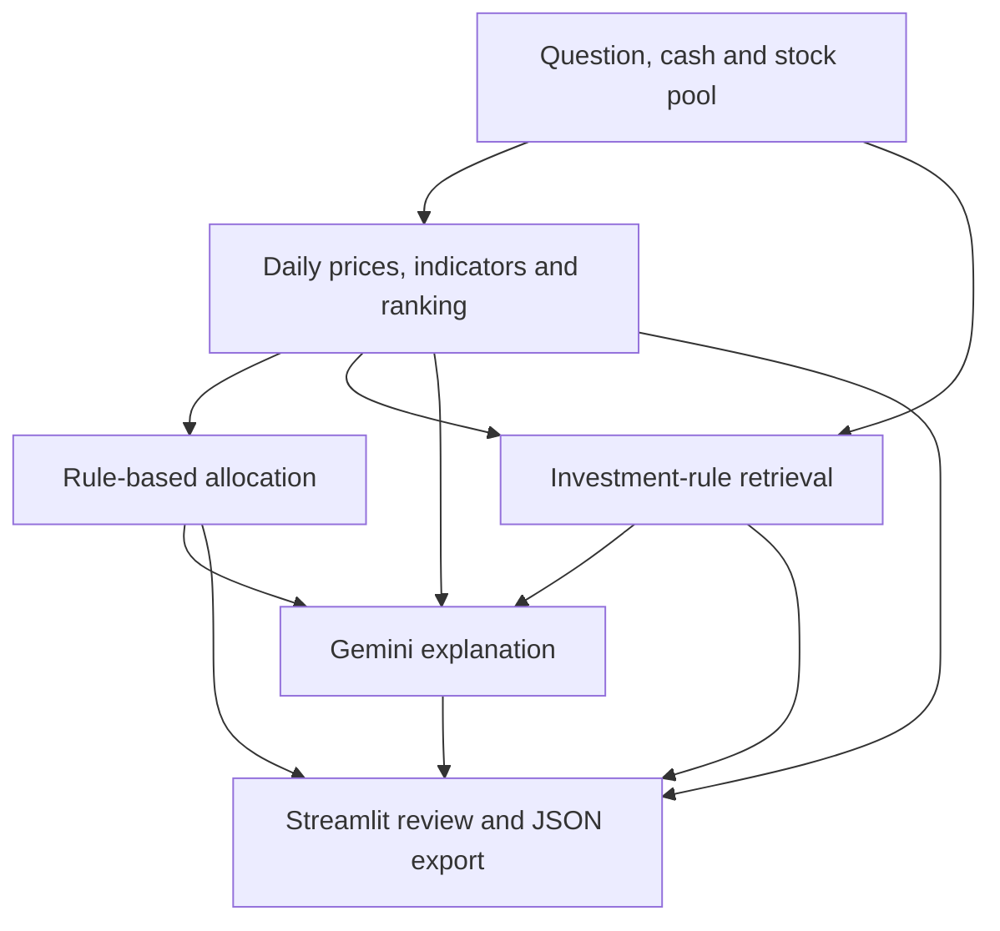

# Quantitative RAG Investment Decision-Support System

[繁體中文](README.zh-TW.md) · [Architecture](docs/architecture.md) · [Evaluation](docs/evaluation.md) · [Latency experiments](docs/latency-experiments.md)

A **Streamlit application for reviewing Taiwan stocks and ETFs**, combining rule-based quantitative scoring, constrained cash allocation, and retrieval-augmented explanations with LangChain, Gemini, and Chroma.

The application turns a question, cash budget, and selected stock pool into a ranked score table, an allocation plan, an explanation in Traditional Chinese, and inspectable reference passages. Numerical scores and allocations are calculated in Python before the LLM generates its explanation.

**Status:** working application prototype with a small local evaluation. The current implementation targets Taiwan instruments; broader market support is a future extension.

[Hosted demo](https://stockaiassistant.streamlit.app/) · [Application entry point](app.py) · [Recorded benchmark summary](docs/benchmarks/observed-results.json)

## What you can do

| Capability | Implementation |
| --- | --- |
| Select a stock pool and cash budget | Streamlit controls with **11 configured instruments: 6 stocks and 5 ETFs**. |
| Inspect quantitative rankings | Six months of daily Yahoo Finance history; MA20, MA60, RSI14, 20-day return and volatility; trend, momentum, and risk subscores. |
| Review a cash allocation plan | Rank up to 5 candidates, retain a cash reserve, apply per-instrument caps, and estimate whole-share quantities. |
| Read an explanation with its sources | Retrieve local investment-rule passages from Chroma and supply them with scores and allocations to Gemini through LangChain. |
| Keep and export a review session | Display session conversation history and download questions, answers, scores, allocation data, and references as JSON. |

## Measured results

Results below come from saved local runs on **September 7–8, 2026**, using `gemini-3.5-flash`. They describe the recorded test conditions, not a service-level guarantee.

| Evaluation | Observed result | Scope |
| --- | --- | --- |
| Knowledge base | **4 rule documents / 8 indexed chunks** | Curated rules, including 0050 and 2330 guidance; not company filings or a news database. |
| Source retrieval | **100% source Hit Rate@1; 95% mean source Recall@5** | 10 annotated queries; filename-level labels over the small corpus. |
| Response checks | **10/10 successful answers passed predefined checks** | At least 2 expected keywords plus a disclaimer; factual accuracy was not scored. |
| Initial response latency | **20.9 s median** | 10 successful full-pipeline calls in the initial live evaluation. |
| Concise-response prototype | **15.2 s median across 4 successful runs** | 2 questions × 2 rounds; all 4 passed keyword/disclaimer checks. |

The concise-response experiment produced **zero eligible matched pairs** because market-data fingerprints changed between baseline and variant requests. Its latency is a descriptive prototype result; a controlled percentage speedup has not been established. Citation coverage and factual correctness remain unmeasured. See the [evaluation protocol and limitations](docs/evaluation.md).

## How the application works



The final-decision route is implemented in [decision/final_decision_chain.py](decision/final_decision_chain.py). The [architecture notes](docs/architecture.md) explain the scoring weights, allocation denominators, retrieval query, and current failure handling.

**Core stack:** Python, pandas, Streamlit, yfinance, LangChain, Google Gemini, Chroma, and Pydantic Settings. The current application stores history in Streamlit session state; the `database/` folder does not implement a database service.

## Run locally

The recorded evaluation used Python **3.13.5 on Windows 11**. The pinned [requirements.txt](requirements.txt) is the existing environment snapshot. A fresh installation and live API run have not been repeated as part of this presentation update.

From PowerShell:

```powershell
git clone https://github.com/yutungamelie/Quantitative_RAG_Investment_Decision-Support_System.git
cd Quantitative_RAG_Investment_Decision-Support_System
python -m venv .venv
.\.venv\Scripts\python.exe -m pip install -r requirements.txt
Copy-Item .env.example .env
```

Edit `.env` with your own API key. The example model matches the recorded evaluation; use a model available to your account and record any change when benchmarking. Consult the [Gemini model catalog](https://ai.google.dev/gemini-api/docs/models) for current availability.

```dotenv
GOOGLE_API_KEY=your_gemini_api_key_here
GEMINI_MODEL=gemini-3.5-flash
```

Build the index once for a fresh checkout, then start the app:

```powershell
.\.venv\Scripts\python.exe -m rag.build_vector_db
.\.venv\Scripts\python.exe -m streamlit run app.py
```

On macOS/Linux, use `.venv/bin/python` in place of `.\.venv\Scripts\python.exe`. Indexing, retrieval embeddings, and answer generation use the configured Gemini API; price requests use Yahoo Finance. The builder creates a persistent Chroma collection. Repeated builds are not an idempotent corpus refresh; use a fresh index for controlled experiments.

## Run the evaluations

The repository includes the existing query cases and the standalone measurement scripts used in the project workflow:

```powershell
# Inspect configured instruments and documents; no API calls.
.\.venv\Scripts\python.exe stock_ai_metrics.py --repo . --output benchmark_runs/static.json

# Run the 10-query retrieval and answer evaluation with live APIs.
.\.venv\Scripts\python.exe stock_ai_metrics.py --repo . --live --output benchmark_runs/live.json

# Profile two full-pipeline requests with live APIs.
.\.venv\Scripts\python.exe stock_ai_latency_lab.py profile --repo . --questions 2 --output benchmark_runs/profile.json
```

Live benchmark scripts build a separate temporary index. Experimental caching, client reuse, and concise prompting apply only inside the latency script's process; they are not enabled in the Streamlit application. Follow the [experiment guide](docs/latency-experiments.md) before interpreting a comparison.

## Repository guide

| Location | Purpose |
| --- | --- |
| [app.py](app.py) | Streamlit interface and session state. |
| [data/](data/) and [quant/](quant/) | Instrument configuration, daily price fetching, indicators, and scoring. |
| [decision/](decision/) | Ranking, allocation, and final-decision orchestration. |
| [rag/](rag/) and [rag_docs/](rag_docs/) | Embedding/index construction, retrieval, prompts, and curated rules. |
| [database/](database/) and [exports/](exports/) | Message helpers and JSON export. |
| [tests/](tests/) | Annotated evaluation cases, API evaluation runners, and offline latency-harness checks. |
| [stock_ai_metrics.py](stock_ai_metrics.py) and [stock_ai_latency_lab.py](stock_ai_latency_lab.py) | Standalone measurement tools. |
| [docs/](docs/) | Architecture, recorded results, experimental protocol, and next steps. |

## Next milestones

- [ ] Freeze comparison inputs and collect more eligible latency pairs before reporting an optimization percentage.
- [ ] Review numerical fidelity and claim-level evidence support in generated answers.
- [ ] Benchmark resource reuse, then combine only the optimizations that pass latency and quality checks.
- [ ] Add explicit data-freshness and partial-data indicators, richer evaluation cases, and a reproducible deployment environment.
- [ ] Evaluate additional markets with market-specific instrument metadata, rules, and test cases.

This project is for learning and decision support. Its scores and allocation rules are heuristics; no investment-return backtest, profitability claim, or automated trading capability is established.
