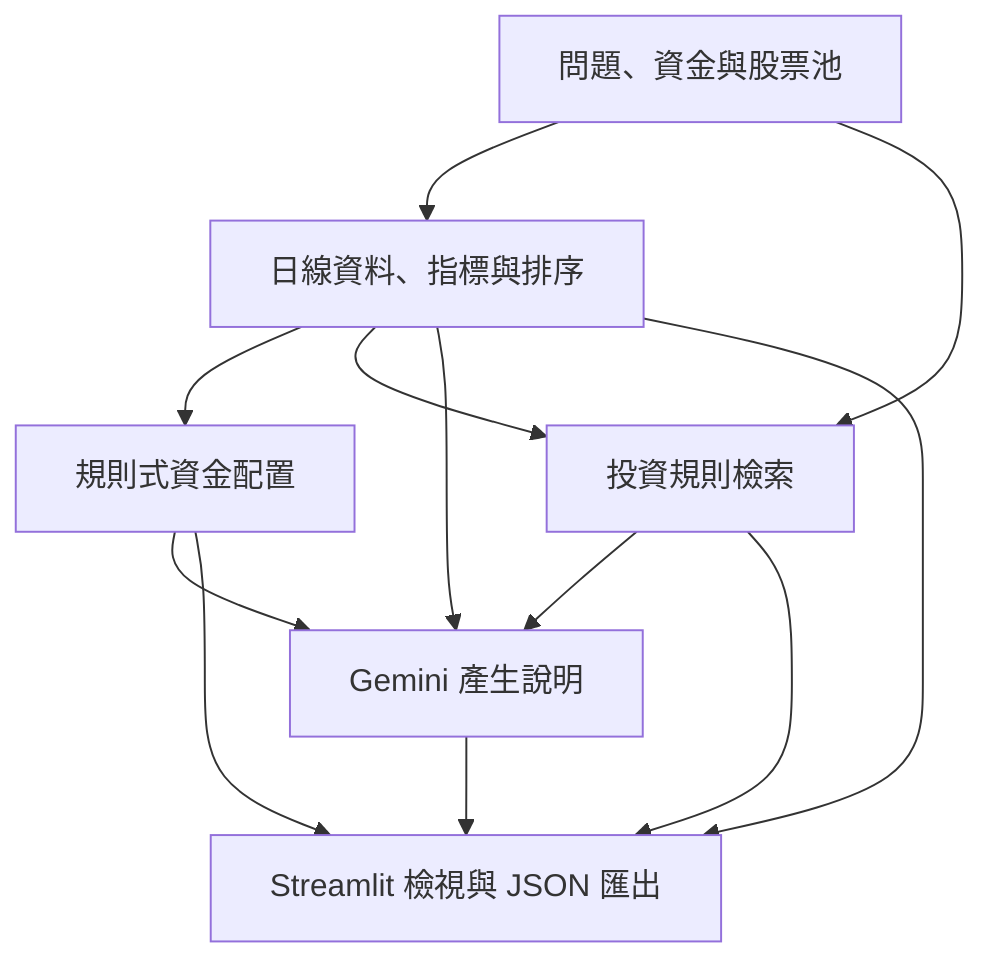

# Quantitative RAG Investment Decision-Support System

**台股量化 RAG 投資決策輔助系統**

[English](README.md) · [系統架構](docs/architecture.md) · [量化成果與評估方法](docs/evaluation.md) · [延遲實驗](docs/latency-experiments.md)

使用 Streamlit、LangChain、Gemini、Chroma 與 yfinance 建立的應用原型，整合**量化評分、規則式資金配置、投資規則檢索及文字說明**。使用者輸入問題、可用資金與股票池後，可以檢視候選標的排序、配置計畫、分析理由和參考段落。

量化分數與配置金額先由 Python 計算，再交給 LLM 整理說明。目前已實作台股／ETF 流程；其他市場屬於後續擴充方向。

[開啟 Hosted Demo](https://stockaiassistant.streamlit.app/) · [查看主程式](app.py) · [實驗結果摘要 JSON](docs/benchmarks/observed-results.json)

## 已完成的功能

| 面向 | 內容 |
| --- | --- |
| 操作介面 | 設定可用資金，從 **11 個已設定標的（6 檔個股、5 檔 ETF）** 選擇股票池。 |
| 行情與評分 | 取得近六個月日線資料，計算 MA20、MA60、RSI14、20 日報酬率與波動率，整理趨勢、動能、風險及總分。 |
| 排序與配置 | 取最多 5 個候選標的，依分數與上限分配可投資資金，保留現金並估算整股數量。 |
| RAG 說明 | 從本地 Markdown 規則庫檢索段落，將量化資料、配置結果及參考內容提供給 Gemini，產生繁體中文說明。 |
| 檢視與匯出 | 顯示參考段落、當次工作階段的對話紀錄，並匯出 JSON。 |

## 目前可支持的量化成果

以下數據來自 **2026 年 9 月 7–8 日的本機實驗紀錄**，使用 `gemini-3.5-flash`。本次更新整理既有紀錄，未重新呼叫 API 補跑實驗。

| 指標 | 結果 | 測試範圍 |
| --- | --- | --- |
| 知識庫規模 | **4 份規則文件、8 個 indexed chunks** | 包含通用規則、風險控管、0050 與 2330 規則；不是財報或新聞資料庫。 |
| 來源檢索 | **Source Hit Rate@1：100%；平均 Source Recall@5：95%** | 10 題已標註問題，以檔名作為來源標籤。 |
| 回答檢查 | **10/10 次回答成功且通過預設檢查** | 至少命中 2 個預期關鍵字，並包含風險聲明；未評分事實正確性。 |
| 初次完整流程延遲 | **中位數 20.9 秒** | 初次 live evaluation 的 10 次成功呼叫。 |
| 精簡回答原型 | **4 次成功測試的中位數為 15.2 秒** | 2 題 × 2 輪；4 次均通過關鍵字與聲明檢查。 |

精簡回答實驗中，baseline 與 variant 的行情指紋不同，因此**符合比較條件的配對數為 0**。目前可以陳述觀察到的延遲，還不能宣稱已驗證「降低延遲 X%」。引用品質與回答中的數字正確性仍需額外審核。詳見[評估說明](docs/evaluation.md)。

## 系統流程



主要整合入口是 [decision/final_decision_chain.py](decision/final_decision_chain.py)。[架構文件](docs/architecture.md) 另外說明評分權重、配置比例的分母、檢索查詢與錯誤處理。

目前對話紀錄儲存在 **Streamlit session state**；`database/` 是訊息處理工具，不是 PostgreSQL 或持久化資料庫。介面可顯示前文，但目前每次呼叫只傳入本次問題與投資設定，尚未把完整對話歷史送入模型。

## 本機執行

原始評估環境是 **Windows 11／Python 3.13.5**。[requirements.txt](requirements.txt) 保留既有環境的套件版本快照；本次文件更新未重新驗證乾淨環境安裝及 live API 執行。

在 PowerShell 執行：

```powershell
git clone https://github.com/yutungamelie/Quantitative_RAG_Investment_Decision-Support_System.git
cd Quantitative_RAG_Investment_Decision-Support_System
python -m venv .venv
.\.venv\Scripts\python.exe -m pip install -r requirements.txt
Copy-Item .env.example .env
```

編輯 `.env`，填入自己的 API key。範例模型與既有實驗相同；若更換模型，請在下一次量測中記錄。可用模型以 [Gemini 官方目錄](https://ai.google.dev/gemini-api/docs/models) 與帳號權限為準。

```dotenv
GOOGLE_API_KEY=your_gemini_api_key_here
GEMINI_MODEL=gemini-3.5-flash
```

初次建立索引後啟動介面：

```powershell
.\.venv\Scripts\python.exe -m rag.build_vector_db
.\.venv\Scripts\python.exe -m streamlit run app.py
```

macOS／Linux 將 Python 路徑改為 `.venv/bin/python`。索引建立、問題 embedding 與回答生成會使用 Gemini API；行情來自 Yahoo Finance。重複執行 builder 並不保證更新後沒有重複 chunks；控制實驗應使用新的索引。

## 重跑評估

```powershell
# 靜態盤點，不呼叫 API。
.\.venv\Scripts\python.exe stock_ai_metrics.py --repo . --output benchmark_runs/static.json

# 10 題檢索與回答量測，會呼叫 API。
.\.venv\Scripts\python.exe stock_ai_metrics.py --repo . --live --output benchmark_runs/live.json

# 2 題完整流程分段計時，會呼叫 API。
.\.venv\Scripts\python.exe stock_ai_latency_lab.py profile --repo . --questions 2 --output benchmark_runs/profile.json
```

兩個 live 量測腳本使用獨立的暫存索引。行情快取、資源重用與精簡回答目前是**量測腳本內的實驗設定**，尚未整合到正式 Streamlit 流程。三種實驗的指令、比較條件及下一步請見[延遲實驗指南](docs/latency-experiments.md)。

## 後續方向

- [ ] 固定比較輸入、增加有效配對，再計算可支持的延遲改善百分比。
- [ ] 人工檢查文字中的金額、股數與逐項引用支持程度。
- [ ] 完成資源重用實驗，將通過速度與品質檢查的優化整合到 App。
- [ ] 補上行情新鮮度、部分資料失敗提示，以及更完整的評估案例與部署環境。
- [ ] 擴充其他市場的標的資訊、規則文件與測試案例。

本專案供學習與決策輔助使用。分數與配置規則屬於啟發式方法，尚未以投資績效回測驗證，也未提供自動下單功能。
